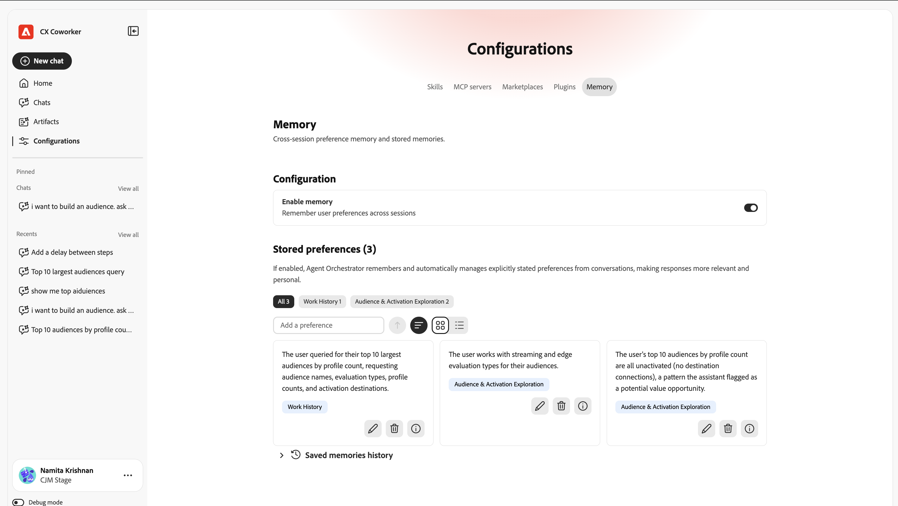

# Introducción al chat con compañeros {#ui-guide}

El chat de Coworker le permite trabajar con los datos y las herramientas de Adobe CX Enterprise preguntando lo que necesita en un lenguaje sencillo. Utilice esta página para abrir Chat del compañero, enviar su primer mensaje y configurarlo de la forma en que trabaja.

## Disponibilidad

[!DNL Coworker] [!UICONTROL Chat] está disponible como una experiencia envolvente, un espacio de trabajo de página completa y como una experiencia integrada al producto en algunas aplicaciones de [!DNL CX Enterprise].

La siguiente tabla muestra dónde está disponible cada experiencia.

| aplicación de CX Enterprise | Experiencia envolvente | Experiencia en el producto |
|---|---|---|
| Real-Time CDP | Disponible ahora | Próximamente |
| Adobe Journey Optimizer | Disponible ahora | Próximamente |
| Customer Journey Analytics | Disponible ahora | Próximamente |
| Workfront | Disponible ahora | Próximamente:  * a principios de septiembre de 2026 en la instancia de vista previa para administradores de sistemas de Workfront seleccionados  * a mediados de septiembre de 2026 en la instancia de producción para clientes de Workfront de lanzamiento rápido aptos  * a mediados de octubre de 2026 en la instancia de producción para clientes de Workfront de lanzamiento trimestral aptos |
| Target | Disponible ahora | Disponible ahora |
| AEM | Disponible ahora | Disponible ahora |
| Marketo Engage | Disponible ahora | Próximamente |

## Abrir [!DNL Coworker] chat {#immersive}

Para utilizar esta experiencia envolvente, inicie sesión con sus credenciales de Adobe. Puede abrirlo desde un vínculo directo o desde CX Enterprise.

1. Vaya a [https://experience.adobe.com/#/coworker](https://experience.adobe.com/#/coworker).
1. Inicie sesión con su Adobe ID.
1. En [!DNL CX Enterprise], haga clic en el menú del selector de aplicaciones  y, a continuación, haga clic en **[!DNL Coworker]**.
1. Para abrir el chat (la experiencia del producto), haz clic en **[!UICONTROL Chats]** .

## Vídeo: Aspectos básicos de la interfaz de chat de [!DNL Coworker]

>[!VIDEO](https://video.tv.adobe.com/v/3498558?learn=on)

## Elija su organización

Su [organización](https://experienceleague.adobe.com/es/docs/core-services/interface/administration/organizations) y zona protegida determinan a qué datos, habilidades y herramientas conectadas puede llegar una conversación. Compruébelo antes de empezar. El contexto actual aparece en la parte inferior del carril de navegación izquierdo, bajo su nombre.

Para cambiar el contexto:

1. Haga clic en su nombre en la parte inferior del carril de navegación para abrir el menú de cuenta.
1. Haga clic en **[!UICONTROL Organización]** y elija la organización de IMS en la que desea trabajar.

   

1. Haga clic en **[!UICONTROL espacio aislado]** y elija el espacio aislado de AEP en el que quiere trabajar.

   

El menú de cuenta también incluye las siguientes opciones:

| Opción | Úselo para lo siguiente |
| --- | --- |
| **[!UICONTROL Tema]** | Cambiar entre los temas Claro y Oscuro. |
| **[!UICONTROL Configuración]** | Ver los detalles de la cuenta y la configuración de Workspace. |
| **[!UICONTROL Aplicaciones CX]** | Vaya a otra aplicación de CX Enterprise conectada a su cuenta. |
| **[!UICONTROL Cerrar sesión]** | Cierre la sesión de su cuenta de Adobe. |

## Encuentra tu camino

El espacio de trabajo tiene dos áreas: el carril de navegación a la izquierda y el lienzo de conversación que ocupa el resto de la ventana.

Utilice el carril de navegación para desplazarse entre las partes del producto y volver al trabajo reciente.

| Opción | Úselo para lo siguiente |
| --- | --- |
| **[!UICONTROL Nuevo chat]** | Iniciar una conversación. Chat del compañero guarda tu chat actual en tu historial. |
| **[!UICONTROL Hogar]** | Vuelva al saludo, al cuadro de entrada y a las sugerencias. |
| **[!UICONTROL Chats]** | Busca, fija, archiva o elimina conversaciones pasadas. |
| **[!UICONTROL Configuraciones]** | Administre aptitudes, servidores MCP, mercados, complementos y memoria. |
| **[!UICONTROL Anclado]** | Abre las conversaciones que has iniciado. Haz clic en **[!UICONTROL Ver todos]** para verlos en la página de Chats. |
| **[!UICONTROL Recientes]** | Abra las conversaciones más recientes. Haz clic en **[!UICONTROL Ver todo]** para abrir la página de chats. |

## Envíe su primer mensaje

La pantalla Inicio muestra un saludo, el cuadro de entrada ([!UICONTROL Chat]) y las indicaciones sugeridas en función de lo que el Chat del compañero puede hacer en su zona protegida. Puede empezar con una sugerencia o escribir su propio mensaje.

Para enviar un mensaje:

1. Haga clic en **[!UICONTROL Inicio]** en el carril de navegación.
1. Realice una de las siguientes acciones:

   * Seleccione un mensaje en **[!UICONTROL Sugerido para usted]**. El chat de compañeros lo añade al cuadro de entrada, donde puede editarlo.
   * Escriba su propia solicitud en el cuadro **[!UICONTROL Preguntar a su compañero]**.

1. (Opcional) Añada contexto, elija cómo responde Chat del compañero o dicte el mensaje. Ver [Agregar contexto y elegir un estilo de respuesta](#input-options).
1. Haga clic en **[!UICONTROL Enviar]**.

>[!TIP]
>
>Las solicitudes sugeridas muestran los tipos de tareas que admite Coworker Chat, como mover esquemas entre entornos limitados, buscar anomalías en un recorrido y validar un conjunto de datos.

Para dirigir Chat de compañeros a un objeto específico de su zona protegida, escriba **+** en el cuadro de entrada y haga clic en un esquema, recorrido, conjunto de datos u otro objeto. Esto se denomina mención de entidad. Le dice a Coworker Chat exactamente a qué objeto te refieres.

## Añadir contexto y elegir un estilo de respuesta {#input-options}

La barra de herramientas situada debajo del cuadro de entrada controla lo que adjunta, el modo en que Coworker Chat aborda la tarea y la cantidad de trabajo que ve.

| Control | Úselo para lo siguiente |
| --- | --- |
| **[!UICONTROL +]** (Adjuntar) | Añada un archivo o un objeto de zona protegida al mensaje. |
| **[!UICONTROL Modo de planificación]** | Revise un plan paso a paso antes de que Coworker Chat actúe. |
| **[!UICONTROL Vista de transcripción]** | Elija la cantidad de actividad de Coworker Chat que ve. |
| **[!UICONTROL Micrófono]** | Dicte su mensaje. Vuelva a hacer clic para detener la grabación. |
| **[!UICONTROL Enviar]** | Envíe su mensaje. Mientras el Chat del compañero responde, este control se convierte en **[!UICONTROL Detener]**, lo que interrumpe la respuesta. |

### Adjuntar un archivo u objeto

Adjunte un archivo u objeto cuando Coworker Chat necesite más información para realizar el trabajo.

1. Haga clic en **[!UICONTROL +]** en el cuadro de entrada.
1. Haga clic en una de las siguientes opciones:

   * **[!UICONTROL Adjuntar archivo]**: Suba un archivo para que Coworker Chat lo lea y haga referencia.
   * **[!UICONTROL Agregar datos u objeto]**: Haga referencia a un objeto en su zona protegida, como un conjunto de datos o esquema, para que Coworker Chat funcione con sus datos activos.

### Revise un plan antes de que Actúe el chat con compañeros de trabajo {#plan-mode}

Utilice el modo de planificación para tareas complejas o tareas que cambien datos. Cuando el modo de planificación está activado, Coworker Chat propone un plan y espera su aprobación antes de que se lleve a cabo. Cuando el modo de planificación está desactivado, Coworker Chat inicia el trabajo de inmediato.

1. Haga clic en **[!UICONTROL Modo de planificación]** en la barra de herramientas de entrada para activarlo.
1. Envíe su mensaje.
1. Revise el plan y apruébelo para continuar.

### Elegir una vista de transcripción

La vista de transcripción controla la cantidad de razonamiento de Coworker Chat y la actividad de la herramienta que aparece en la conversación.

1. Haga clic en **[!UICONTROL Vista de transcripción]** en la barra de herramientas de entrada.
1. Haga clic en una vista:

   | Ver | Lo que ve |
   | --- | --- |
   | **[!UICONTROL Normal]** | Un resumen de los pasos clave del pensamiento y la actividad de la herramienta. |
   | **[!UICONTROL Enfoque]** | Principalmente la respuesta. El chat de compañeros oculta la mayoría de los pasos intermedios. |
   | **[!UICONTROL Detallado]** | Cada paso de reflexión, carga de aptitudes, lectura de archivos y consulta. |

## Revisar una respuesta

El chat de compañeros muestra su trabajo tal cual, y devuelve una respuesta. Una respuesta puede incluir su razonamiento, un registro de las herramientas que utilizó, artefactos y un resumen.

### Siga la actividad

Mientras que Chat de Coworker funciona, usted puede seguir y verificar lo que hace. Expanda cualquier entrada para ver más detalles.

* **Pensado para**: Un bloque plegable con el razonamiento de Coworker Chat y cuánto tiempo tardó.
* **Aptitud cargada**: La capacidad especializada que el Chat del compañero utilizó para la tarea.
* **Leer archivo** y **Ejecutar 1 consulta**: Los archivos que Chatea con el compañero leyó y las consultas que ejecutó, con el tiempo que cada una tomó.

>[!TIP]
>
>Establece **[!UICONTROL Vista de transcripción]** en **[!UICONTROL Detallado]** para ver cada paso o en **[!UICONTROL Enfoque]** para ocultarlos.

### Trabajo con artefactos

El chat de compañeros muestra los resultados, como una tabla de audiencias, como tarjetas de artefactos en la respuesta. Puede descargar un artefacto de tabla como archivo CSV desde su tarjeta. Cuando una respuesta incluya más de un artefacto, usa **[!UICONTROL Anterior]** y **[!UICONTROL Siguiente]** para moverte entre ellos.

### Usar el resumen

Debajo de los artefactos, Coworker Chat explica qué significan los resultados, resalta hallazgos notables y sugiere acciones de seguimiento. Utilice estas sugerencias para continuar la conversación.

### Valorar y copiar una respuesta

Cada respuesta incluye controles que puede utilizar para proporcionar comentarios o reutilizar el contenido.

* Haga clic en **[!UICONTROL Pulgares arriba]** o **[!UICONTROL Pulgares abajo]** para evaluar la respuesta. Tu valoración ayuda a mejorar las respuestas futuras.
* Haga clic en **[!UICONTROL Copiar]** y, a continuación, elija **[!UICONTROL Copiar como Markdown]** para mantener el formato o **[!UICONTROL Copiar como texto sin formato]** para quitarlo.

## Administrar los chats

Tu historial de chat mantiene conversaciones pasadas para que puedas volver a ellas. Haga clic en **[!UICONTROL Chats]** en el carril de navegación para abrirlo. Las conversaciones se agrupan por fecha y cada fila muestra el título y el número de turnos.

En la página Chats puede:

* Escriba un nombre en **[!UICONTROL Buscar por título]** para encontrar una conversación.
* Haz clic en **[!UICONTROL Mostrar anclado]** para ver solamente las conversaciones que has iniciado.
* Haz clic en **[!UICONTROL Mostrar]** para ver las conversaciones archivadas.
* Haz clic en **[!UICONTROL Nuevo chat]** para iniciar una conversación.

Para fijar, cambiar el nombre, archivar o eliminar una conversación, haga clic en el menú de fila (**[!UICONTROL ...]**) de su fila y elija una opción.

## Personalizar chat con compañeros

[!UICONTROL Personalizaciones] es donde controlas lo que [!UICONTROL Chat del compañero] puede hacer. Haga clic en **[!UICONTROL Personalizaciones]** en el carril de navegación y, a continuación, elija una pestaña: **[!UICONTROL Aptitudes]**, **[!UICONTROL Integraciones]**, **[!UICONTROL Mercados]**, **[!UICONTROL Complementos]** o **[!UICONTROL Memoria]**.

### Adición y visualización de aptitudes

Las habilidades son capacidades especializadas que Coworker Chat utiliza automáticamente cuando se aplican. También puede empezar una aptitud escribiendo **/** en el chat. La ficha **[!UICONTROL Aptitudes]** enumera todas las aptitudes instaladas.

1. En la ficha **[!UICONTROL Aptitudes]**, haga clic en **[!UICONTROL Agregar aptitudes]** para instalar aptitudes desde una nueva fuente.
1. Escriba un nombre en **[!UICONTROL Buscar]** para encontrar una aptitud.
Utilice el conmutador de vista para cambiar entre los diseños de cuadrícula y lista.
1. Seleccione una aptitud para ver el complemento al que pertenece, cuándo lo utiliza Chat del compañero y los archivos que incluye.

   

1. (Opcional) Haga clic en **[!UICONTROL Ver aptitud.md]** para leer la definición completa de la aptitud o haga clic en **[!UICONTROL Quitar Source]** para desinstalar la aptitud.

   

### Conexión de servidores MCP

Los servidores de Protocolo de contexto de modelo (MCP, Model Context Protocol ) conectan el Chat del compañero con herramientas y servicios externos, como Adobe Journey Optimizer, Real-Time CDP, Target y Workfront. La ficha **[!UICONTROL Servidores MCP]** enumera los servidores conectados y el número de conexiones activas. Cada tarjeta muestra el nombre del servidor, su punto final y las etiquetas que describen lo que proporciona.

Para conectar un servidor, haga clic en **[!UICONTROL Agregar servidor]** y siga las indicaciones.

### Agregar un mercado

Un Marketplace es un registro de complementos que puede examinar e instalar desde. En la ficha **[!UICONTROL Marketplaces]**, haga clic en **[!UICONTROL Agregar Marketplace]** para registrar una nueva. Use **[!UICONTROL Buscar]** o filtre por grupo para reducir la lista. Hay un mercado con un estado **Listo** disponible para la instalación.

### Administración de complementos

Un complemento agrupa habilidades y servidores MCP para que pueda instalarlos y administrarlos juntos. La pestaña **[!UICONTROL Plugins]** muestra los complementos instalados.

* Haga clic en **[!UICONTROL Examinar mercados]** para buscar nuevos complementos.
* Filtre por mercado para ver de dónde proviene cada complemento.
* Haz clic en **[!UICONTROL Desinstalar]** para quitar un complemento y todo lo que incluye.

### Administrar memoria

La memoria permite que Coworker Chat recuerde sus preferencias en todas las conversaciones, por lo que las respuestas siguen siendo relevantes con el tiempo. Use la ficha **[!UICONTROL Memoria]** para controlar lo que guarda.

1. Haga clic en **[!UICONTROL Memoria]** en la página Configuraciones.
1. Activar **[!UICONTROL Habilitar memoria]**. Desactívela para evitar que el chat de compañeros recuerde entre sesiones.
1. En **[!UICONTROL Preferencias almacenadas]**, revise lo que el chat de compañeros guardó. Puede editar, eliminar o inspeccionar cada entrada y filtrar las entradas por categoría.
1. Use **[!UICONTROL Historial de recuerdos guardados]** para ver una cronología de cambios en sus recuerdos.

