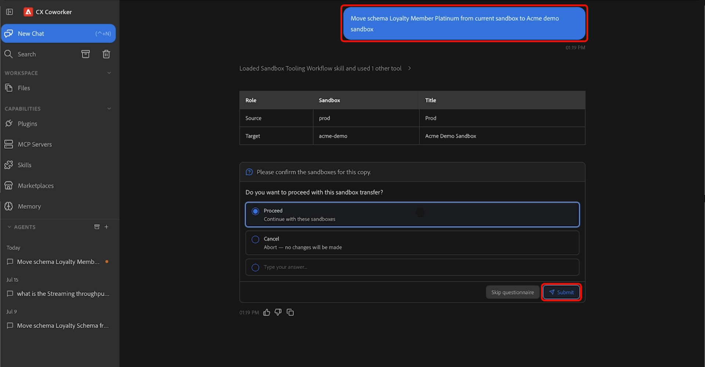

# Aptitudes agénticas de herramientas de zona protegida

>[!AVAILABILITY]
>
>Las habilidades de agente de herramientas de zona protegida están disponibles para todos los clientes con acceso a Adobe CX Enterprise Coworker. Para utilizar todas las funciones disponibles, necesita los siguientes permisos:
>
>**Manage-sandbox** o **View-sandbox**: estos permisos le permiten utilizar habilidades de agente de herramientas de espacio aislado para ver espacios aislados directamente en Coworker.
>
>**Administrar paquete**: Este permiso le permite usar Habilidades de agente de herramientas de espacio aislado para crear paquetes directamente en Compañero de trabajo.

Utilice las habilidades de agente de herramientas de espacio aislado para mover los tipos de objetos admitidos entre entornos de Adobe Experience Platform, describiendo lo que desea lograr en lenguaje natural. Con Coworker, puede descubrir los metadatos necesarios, identificar automáticamente las dependencias, crear paquetes de migración y migrar objetos a través de una experiencia conversacional.

>[!VIDEO](https://video.tv.adobe.com/v/3496706?learn=on)

## Requisitos previos {#prerequisites}

Antes de empezar, asegúrese de que dispone de lo siguiente:

- Acceso a Adobe Experience Platform y a la organización y zona protegida adecuadas.
- Acceso a los objetos que desea descubrir o migrar.
- El complemento CXO de Adobe instalado en Coworker.

Para obtener instrucciones sobre la instalación de complementos, consulte la [guía de la interfaz de usuario de Coworker](https://experienceleague.adobe.com/en/docs/cx-enterprise-ai/experience-cloud-ai/coworker/chat/ui-guide).

## Uso de habilidades de agente de herramientas de espacio aislado {#use-sandbox-tooling-agentic-skills}

Interactúe con Sandbox Tooling Agentic Skills a través de Coworker usando lenguaje natural. Describa su objetivo con la mayor claridad posible. Las solicitudes específicas producen los mejores resultados, mientras que las solicitudes vagas o demasiado breves pueden devolver resultados de menor calidad o no invocar al agente.

Para utilizar las habilidades de agente de herramientas de espacio aislado:

1. Vaya a **[!UICONTROL CX Coworker]**.
1. Escriba una descripción clara de lo que desea lograr. Por ejemplo:

   *&quot;Mover el miembro Platino de fidelidad de esquema de la zona protegida actual a la zona protegida de demostración de Acme.&quot;*

1. Revise la tabla de resultados, que muestra los entornos limitados de origen y destino. Cuando esté listo para continuar, seleccione **[!UICONTROL Continuar]** y, a continuación, seleccione **[!UICONTROL Enviar]** para confirmar.

   

1. Seleccione uno o varios objetos que desee migrar y, a continuación, seleccione **[!UICONTROL Enviar]**.

   

1. Revise los objetos y dependencias que el agente identifica y confirme las acciones de la operación: *Crear nuevo* o *Usar existente*. Cuando esté listo para comenzar la migración, seleccione **[!UICONTROL Continuar]** y, a continuación, seleccione **[!UICONTROL Enviar]** para confirmar. La migración puede tardar varios minutos en completarse.

   

1. Cuando finaliza la migración, los objetos seleccionados están disponibles en la zona protegida de destino.

   

Para obtener más información sobre cómo usar Coworker, consulte la [guía de la interfaz de usuario de Coworker](https://experienceleague.adobe.com/en/docs/cx-enterprise-ai/experience-cloud-ai/coworker/chat/ui-guide).

## Casos de uso admitidos {#supported-use-cases}

Explore formas comunes de utilizar las habilidades agénticas de la herramienta de uso de zonas protegidas para simplificar la administración de zonas protegidas y la migración de metadatos.

### Mover metadatos de objeto entre zonas protegidas

Como administrador de zona protegida que administra varios entornos limitados de Adobe Experience Platform, puede migrar los metadatos de los objetos mediante solicitudes en lenguaje natural en lugar de navegar manualmente por la interfaz de usuario.

Con Coworker, puede migrar objetos de Adobe Experience Platform compatibles y sus metadatos asociados de una zona protegida a otra describiendo la migración en lenguaje natural. Las habilidades de agente de herramientas de zona protegida identifican automáticamente las dependencias, empaquetan los objetos necesarios y ayudan a garantizar una migración fiable entre entornos.

Por ejemplo:

- &quot;Mueva el esquema Platino de los miembros de fidelidad de Luma de la zona protegida actual a la zona protegida de producción&quot;.

### Promocionar objetos en varias zonas protegidas (Beta)

>[!NOTE]
>
>Actualmente, la administración de varios entornos limitados está en Beta y solo admite esquemas y conjuntos de datos.

Como administrador de zona protegida, puede promocionar los objetos admitidos de una zona protegida de origen a varias zonas protegidas de destino en un solo flujo de trabajo. En lugar de importar un paquete en cada zona protegida individualmente, utilice Coworker para seleccionar zonas protegidas de destino, revisar los cambios propuestos e implementar configuraciones de forma coherente en todos los entornos. La administración de varias zonas protegidas resuelve automáticamente las dependencias y proporciona una vista previa de los cambios antes de que comience la promoción.

Por ejemplo:

- &quot;Promocionar el esquema de miembro socio a todos los entornos limitados regionales.&quot;

### Promocionar audiencias entre zonas protegidas

Como administrador de zona protegida, puede promocionar audiencias entre entornos sin volver a crearlas o configurarlas manualmente.

Por ejemplo:

- &quot;Promocione la audiencia &#39;Nombre de audiencia&#39; a la zona protegida de ensayo.&quot;

Las habilidades de agente de herramientas de zona protegida identifican la audiencia especificada, validan sus dependencias y migran todos los objetos necesarios a la zona protegida de destino.

## Ejemplos de peticiones {#example-prompts}

Utilice las siguientes indicaciones como ejemplos al interactuar con las habilidades de agente de herramientas de zona protegida.

### Mensajes de esquema

Utilice estas indicaciones cuando conozca el nombre del esquema y la zona protegida de destino.

- &quot;Mover el esquema &#39;Nombre del esquema&#39; de la zona protegida actual a la zona protegida de producción.&quot;

### Mensajes de audiencia

Utilice estas indicaciones cuando conozca el nombre de la audiencia.

- &quot;Promocione la audiencia &#39;Nombre de audiencia&#39; a la zona protegida de ensayo.&quot;

## Próximos pasos {#next-steps}

Después de leer esta guía, debe comprender cómo utilizar las habilidades de agente de herramientas de espacio aislado para descubrir, empaquetar y migrar objetos admitidos entre espacios aislados.

Para obtener más información sobre las herramientas de zonas protegidas, consulte la [Guía de herramientas de zonas protegidas](https://experienceleague.adobe.com/en/docs/experience-platform/sandbox/ui/sandbox-tooling).

