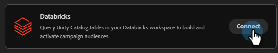
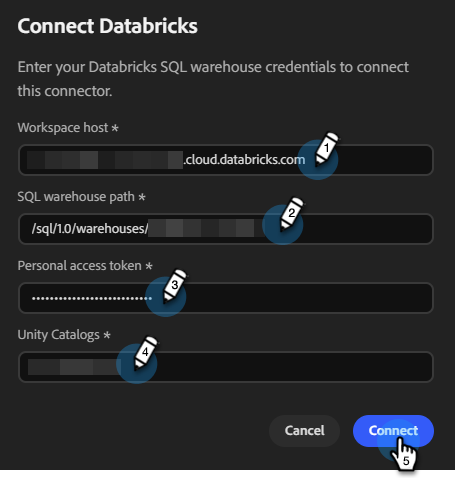

# Conectar con Databricks {#databricks}

Coworker para equipos le permite conectarse y consultar tablas del catálogo Unity en su espacio de trabajo de Databricks para crear y activar audiencias de campaña.

>[!PREREQUISITES]
>
>Para utilizar este conector, primero debe tener:
>
>* Una cuenta activa de Databricks
>* Su host de Workspace de Databricks, [ruta de acceso al almacén SQL](https://docs.databricks.com/aws/en/compute/sql-warehouse/create){target="_blank"}, [token de acceso personal](https://learn.microsoft.com/en-us/azure/databricks/dev-tools/auth/pat){target="_blank"} y [catálogos Unity](https://learn.microsoft.com/en-us/azure/databricks/discover/database-objects){target="_blank"} son útiles.

## Cómo conectar

1. En la página principal de [Colaborador para equipos](https://coworker-campaigns.experience.adobe.com/){target="_blank"}, haga clic en **Contexto** y seleccione **Conectores**.

   

1. Haga clic en **Agregar integración**.

   

   >[!NOTE]
   >
   >Si esta no es su primera integración, el botón dirá &quot;Agregar conector&quot;.

1. En la fila Databricks, haga clic en **Conectar**.

   

1. Escriba sus catálogos Databricks **Workspace host**, **ruta de acceso al almacén SQL**, **token de acceso personal** y **Unity**. Haga clic en **Conectar**.

   >[!NOTE]
   >
   >En la página de inicio de Databricks, el host de Workspace se puede encontrar directamente en la barra de direcciones del explorador. Para localizar todas las demás credenciales, consulte los vínculos de **Requisitos previos** que aparecen en la parte superior de este artículo.

   

Después de la conexión, Databricks aparece en la lista Conectores.

**Para desconectar:**

1. En la pantalla Conectores, busque el mosaico de Databricks y haga clic en **Administrar**.

1. Haga clic en **Desconectar** (no es necesario volver a introducir el token de acceso personal en este momento).

1. Vuelva a hacer clic en **Desconectar** para confirmar.
