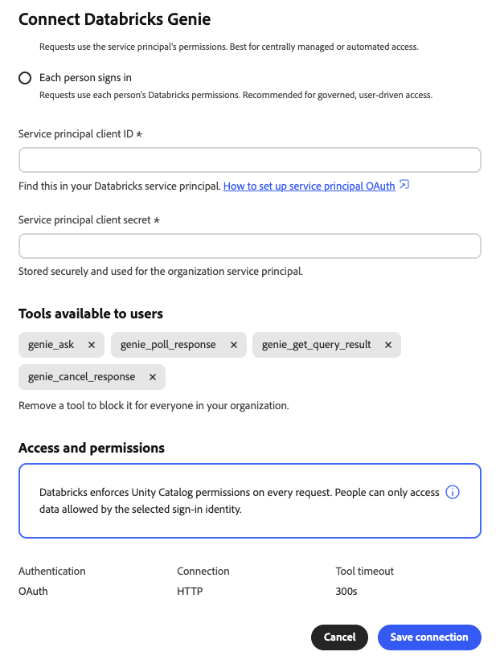

# Conector externo Databricks Genie {#databricks-genie}

Utilice el conector externo [!DNL Databricks Genie] para hacer preguntas acerca de sus datos de [!DNL Databricks] en lenguaje sencillo en Adobe CX Enterprise Coworker. [!DNL Genie] escribe el SQL y devuelve las respuestas en el chat. El conector vincula a Coworker con el servidor de Protocolo de contexto de modelo (MCP) [!DNL Genie One] en el área de trabajo [!DNL Databricks].

>[!AVAILABILITY]
>
>El conector externo [!DNL Databricks Genie] está en versión beta. La documentación y las funcionalidades están sujetas a cambios.

## Configuración del conector {#connector-configuration}

El proceso de configuración del conector tiene dos partes independientes:

* **Configuración de la organización:** Un administrador conecta a un colaborador con un área de trabajo de [!DNL Databricks], elige cómo inician sesión las personas y selecciona las herramientas que pueden utilizar los miembros.
* **Acceso de miembro:** Los miembros utilizan la conexión con una identidad de organización compartida o con su propia identidad [!DNL Databricks], según la opción de inicio de sesión.

El administrador elige una de las siguientes opciones de inicio de sesión:

| Opción | Lo que proporciona el administrador | Cómo funciona el acceso |
| --- | --- | --- |
| **[!UICONTROL Entidad de seguridad del servicio de organización]** | Identificador de cliente y secreto de cliente de una entidad de seguridad de servicio [!DNL Databricks]. | Todos los miembros utilizan los permisos de la entidad de seguridad de servicio. Los miembros no inician sesión en [!DNL Databricks]. |
| **[!UICONTROL Cada persona inicia sesión]** | El identificador de cliente de una conexión de aplicación OAuth [!DNL Databricks] y un secreto de cliente opcional. | Cada miembro inicia sesión con su propia identidad [!DNL Databricks] y el acceso sigue sus permisos [!DNL Databricks]. |

Ninguna de las opciones concede a [!DNL Databricks] permisos que la identidad seleccionada aún no tiene. [!DNL Databricks] exige permisos de [!DNL Unity Catalog] en cada solicitud.

## Requisitos previos {#prerequisites}

Este conector funciona con [!DNL Databricks Genie One]. No admite direcciones URL de MCP de espacio [!DNL Genie] heredadas. Para conectar otro servidor MCP [!DNL Databricks], como un servidor [!DNL Databricks SQL], agréguelo por separado como una integración.

Antes de empezar, asegúrese de que dispone de lo siguiente:

* **Para la configuración de la organización:** Cuenta con permiso para administrar conectores de organización en Coworker.
* **Para el área de trabajo [!DNL Databricks]:** La dirección URL HTTPS de un área de trabajo donde [!DNL Genie One] está disponible.
* **Para la opción de entidad de seguridad de servicio:** El identificador de cliente y el secreto de cliente de una entidad de seguridad de servicio [!DNL Databricks].
* **Para la opción de inicio de sesión por persona:** Una conexión de aplicación OAuth [!DNL Databricks] y su ID de cliente. También necesita un administrador de [!DNL Databricks] que pueda registrar la URL de redireccionamiento de Coworker.
* **Para el acceso de [!DNL Databricks]:** Workspace, [!DNL Genie] y permisos de datos para la identidad que se usará. El compañero no concede estos permisos.

>[!IMPORTANT]
>
>Nunca comparta secretos de clientes, tokens de acceso u otras credenciales en capturas de pantalla, chats ni tickets de asistencia.

Para obtener instrucciones, consulte la siguiente documentación de [!DNL Databricks]:

* [MCP de Genie One](https://docs.databricks.com/aws/en/agents/mcp-tools/genie-mcp){target="_blank"}
* [Habilitar o deshabilitar aplicaciones de OAuth de socio](https://docs.databricks.com/aws/en/integrations/enable-disable-oauth){target="_blank"}
* [Autorizar el acceso principal del servicio a Databricks con OAuth](https://docs.databricks.com/aws/en/dev-tools/auth/oauth-m2m){target="_blank"}

## Configure el conector para su organización {#configure-organization}

Los administradores ponen el conector [!DNL Databricks Genie] a disposición de todos los miembros de la organización. Los cambios en la página de organización se aplican a todos los usuarios de la organización. Solo un administrador de organización puede agregar esta conexión. Los miembros no pueden configurarlo desde la vista **[!UICONTROL Usuario]**.

1. Abra **[!UICONTROL Personalizaciones]**, seleccione **[!UICONTROL Organización]** y luego seleccione **[!UICONTROL Conectores externos]**. En la tarjeta **[!UICONTROL Databricks Genie]**, seleccione **[!UICONTROL Configurar]**.

1. En el cuadro de diálogo **[!UICONTROL Conectar genio de Databricks]**, escriba la URL de área de trabajo o la URL de MCP [!DNL Genie One] en **[!UICONTROL URL de servidor]**. El compañero guarda el origen en este formato:

   ```text
   https://<workspace-host>/ai-gateway/mcp-services/system.ai.genie_one_mcp
   ```

   Utilice la dirección URL de su propio espacio de trabajo. El compañero rechaza las direcciones URL que no utilizan HTTPS o que utilizan rutas no admitidas. No se admiten las direcciones URL de espacio heredadas de [!DNL Genie], como `/api/2.0/mcp/genie/<space-id>`.

1. En **[!UICONTROL ¿Quién inicia sesión?]**, seleccione una opción de inicio de sesión y, a continuación, complete su configuración.

   {width="500" zoomable="yes"}

   * **[!UICONTROL Entidad de seguridad del servicio de organización]:** Las solicitudes utilizan los permisos de la entidad de seguridad del servicio. Utilice esta opción para el acceso automatizado o administrado centralmente. Los miembros no inician sesión en [!DNL Databricks].

     | Configuración | Descripción |
     | --- | --- |
     | **[!UICONTROL ID de cliente principal de servicio]** | Requerido. Identificador de cliente de la entidad de seguridad de servicio [!DNL Databricks]. Para configurar la entidad de seguridad de servicio, seleccione **[!UICONTROL Cómo configurar OAuth]** de la entidad de seguridad de servicio en el cuadro de diálogo. |
     | **[!UICONTROL Secreto de cliente principal de servicio]** | Requerido. Secreto de cliente de la entidad de seguridad de servicio. El compañero almacena el secreto de forma segura y lo utiliza para el principal del servicio de organización. |

   * **[!UICONTROL Cada persona inicia sesión]:** Las solicitudes utilizan los permisos de [!DNL Databricks] de cada persona. Utilice esta opción para obtener acceso controlado y controlado por el usuario. Cada miembro autoriza la aplicación con su propia identidad [!DNL Databricks].

     | Configuración | Descripción |
     | --- | --- |
     | **[!UICONTROL URL de redireccionamiento]** | Sólo lectura. Copie esta dirección URL y agréguela al registrar a Coworker como una conexión de aplicación OAuth en la consola de cuentas de [!DNL Databricks]. Para obtener instrucciones, seleccione **[!UICONTROL Cómo agregar una conexión de aplicación OAuth]** en el cuadro de diálogo. La dirección URL de redireccionamiento difiere entre entornos, por lo que siempre debe copiarla del cuadro de diálogo. |
     | **[!UICONTROL ID de cliente de aplicación OAuth]** | Requerido. Identificador de cliente que [!DNL Databricks] muestra después de crear la conexión de aplicación. El compañero lo usa para enviar a cada persona a la página de inicio de sesión de [!DNL Databricks]. |
     | **[!UICONTROL secreto de cliente de aplicación OAuth]** | Opcional. Introduzca el secreto solo si ha creado la conexión de la aplicación como cliente confidencial. Sin un secreto de cliente, la aplicación utiliza una configuración de cliente pública. |

   El compañero deriva las direcciones URL y los ámbitos de OAuth del espacio de trabajo. El tipo de autenticación y el protocolo de conexión son fijos y de solo lectura. Siga el proceso de aprobación de su organización para la aplicación OAuth y el acceso que solicita.

   >[!IMPORTANT]
   >
   >Con una entidad de seguridad de servicio de organización, todas las personas que utilicen esta conexión actuarán con los permisos de la entidad de seguridad de servicio.

1. En **[!UICONTROL Herramientas disponibles para los usuarios]**, elija las herramientas que pueden utilizar los miembros. El conector proporciona las siguientes herramientas, todas disponibles de forma predeterminada:

   | Herramienta | Descripción |
   | --- | --- |
   | `genie_ask` | Hacer una pregunta a [!DNL Genie]. |
   | `genie_poll_response` | Comprobar el estado de una respuesta que aún está en curso. |
   | `genie_get_query_result` | Recupere resultados de consultas. |
   | `genie_cancel_response` | Cancelar una respuesta. |

   Para bloquear una herramienta para todos los miembros de su organización, elimine su etiqueta. El compañero guarda las herramientas eliminadas como exclusiones para su organización. Al menos una herramienta debe permanecer habilitada. Después de quitar una herramienta, aparecerá la opción **[!UICONTROL Restaurar todas las herramientas]**. Selecciónelo para borrar las exclusiones y hacer que todas las herramientas vuelvan a estar disponibles.

   {width="500" zoomable="yes"}

   Los miembros sólo pueden ver y utilizar las herramientas que deje habilitadas y no pueden cambiar la selección de herramientas. Al habilitar una herramienta, los miembros no reciben permisos adicionales de [!DNL Databricks]. El tiempo de espera de la herramienta se fija en 300 segundos.

1. Revise **[!UICONTROL Acceso y permisos]** y, a continuación, seleccione **[!UICONTROL Guardar conexión]**. La tarjeta **[!UICONTROL Databricks Genie]** muestra **[!UICONTROL Configuración guardada]**.

   Seleccione **[!UICONTROL Ver configuración]** para revisar el espacio de trabajo, la autenticación, las herramientas habilitadas y el tiempo de espera de la herramienta. Luego selecciona **[!UICONTROL Probar]** para comprobar la conexión.

   {width="700" zoomable="yes"}

Una prueba correcta no confirma que la identidad seleccionada tenga los permisos [!DNL Databricks] que necesita.

## Uso del conector como miembro {#use-as-member}

Cuando un administrador haya configurado el conector, ábralo desde su propia vista de **[!UICONTROL personalizaciones]**. Los miembros pueden ver y probar la conexión, pero no pueden cambiarla ni quitarla.

1. Abra **[!UICONTROL Personalizaciones]**, seleccione **[!UICONTROL Usuario]** y, a continuación, seleccione **[!UICONTROL Conectores externos]**.

1. Encuentra la tarjeta **[!UICONTROL Databricks Genie]**. Si su organización no ha configurado el conector, la tarjeta muestra **[!UICONTROL No configurado]** y **[!UICONTROL No disponible aún. El administrador debe configurar esto.]** No hay ningún botón **[!UICONTROL Configurar]** para los miembros, así que pídale al administrador que [configure el conector](#configure-organization).

1. Si su organización utiliza una entidad de seguridad de servicio, la tarjeta muestra **[!UICONTROL Disponible a través de su organización]**. No es necesario que inicie sesión. Para comprobar la conexión, abra los detalles del conector y seleccione **[!UICONTROL Probar conexión]**.

   {width="700" zoomable="yes"}

   Una prueba que se realizó correctamente muestra **[!UICONTROL Conexión correcta]** y la cantidad de herramientas disponibles.

   {width="700" zoomable="yes"}

1. Si su organización usa el inicio de sesión por persona, en la tarjeta aparecerá **[!UICONTROL Se requiere el inicio de sesión]**. Abra el conector, inicie sesión e inicie sesión en [!DNL Databricks] con la cuenta deseada. Complete los pasos necesarios de inicio de sesión único (SSO) o autenticación multifactor (MFA).

1. Después de volver a Compañero de trabajo, confirme que el conector muestra **[!UICONTROL Conectado]**. Revise las herramientas que habilitó el administrador y seleccione **[!UICONTROL Probar conexión]** si es necesario.

La vista de miembros es de sólo lectura. Muestra el estado de la conexión y las herramientas que habilitó el administrador. No introduzca el secreto de cliente de OAuth de la organización ni cambie la selección de la herramienta. Si la conexión falla, los detalles del conector muestran un error y detalles técnicos. Copie los detalles técnicos y compártalos con el administrador.

Un estado de conexión no garantiza el acceso a datos específicos. [!DNL Databricks] permisos de área de trabajo, [!DNL Genie] y datos siguen aplicándose.

## Solucionar problemas de acceso {#troubleshoot-access}

Si se produce un error en la configuración, el inicio de sesión o el acceso, consulte lo siguiente con el administrador:

| Problema | Qué comprobar |
| --- | --- |
| Se rechaza la URL del servidor | La dirección URL utiliza HTTPS y es el origen del espacio de trabajo o la dirección URL exacta de MCP [!DNL Genie One]. Elimine las rutas de espacio heredadas de [!DNL Genie] y otras rutas no admitidas. |
| El inicio de sesión en OAuth falla o la URL de redireccionamiento no coincide | La conexión de la aplicación OAuth [!DNL Databricks] tiene la dirección URL de redireccionamiento exacta desde el mismo entorno de Coworker. El ID de cliente y, si se utiliza, el secreto de cliente son correctos. |
| Error en la conexión principal de servicio | El ID de cliente y el secreto de cliente pertenecen al principal de servicio deseado, el secreto de cliente es válido y el principal de servicio tiene acceso al espacio de trabajo. |
| Inicio de sesión correcto, pero [!DNL Genie] solicitudes fallan | El miembro o la entidad de seguridad de servicio tiene los permisos de espacio de trabajo, [!DNL Genie] y datos necesarios. El administrador puede revisar los detalles técnicos y las herramientas habilitadas. |
| Un miembro no puede ver ni configurar el conector | Un administrador debe configurar primero [!DNL Databricks Genie] en la vista **[!UICONTROL Org]**. Los miembros no pueden crear esta conexión. |
