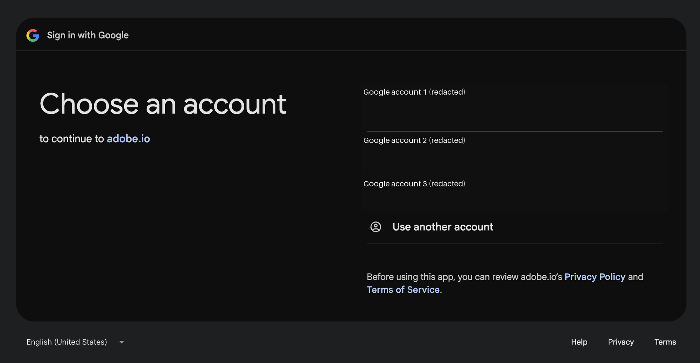

# Conector externo de Google BigQuery {#google-bigquery}

Utilice el conector externo [!DNL Google BigQuery] para explorar y consultar los datos de [!DNL BigQuery] en Adobe CX Enterprise Coworker. Después de configurar el conector, pídale a su compañero que muestre los conjuntos de datos y las tablas, explique un esquema de tabla y ejecute consultas SQL de solo lectura. El conector es un servidor de Protocolo de contexto de modelo (MCP) alojado por [!DNL Google] en `https://bigquery.googleapis.com/mcp`.

>[!AVAILABILITY]
>
>El conector externo [!DNL Google BigQuery] está en versión beta. La documentación y las funcionalidades están sujetas a cambios.

## Configuración del conector {#connector-configuration}

El proceso de configuración del conector tiene tres partes independientes:

* **[!DNL Google Cloud]preparación:** Un administrador de [!DNL Google Cloud] prepara un proyecto de consulta, habilita la API de [!DNL BigQuery] y concede a los miembros los roles necesarios de Administración de acceso e identidad (IAM).
* **Configuración de la organización:** Un administrador de Coworker configura el conector una vez para toda la organización. El administrador conecta la aplicación OAuth [!DNL Google] de la organización y selecciona las herramientas que los miembros pueden utilizar.
* **Inicio de sesión de miembro:** Cada miembro inicia sesión con su propia cuenta de [!DNL Google]. Los miembros solo pueden tener acceso a los proyectos y conjuntos de datos a los que puede tener acceso su identidad [!DNL Google].

El conector utiliza una aplicación OAuth de la que es propietaria su organización. Adobe no proporciona una aplicación OAuth [!DNL Google] para este conector. Al guardar la configuración de la organización, no se inicia sesión en ningún miembro ni se conceden permisos de [!DNL BigQuery]. Un inicio de sesión correcto de [!DNL Google] tampoco concede acceso al conjunto de datos, ya que [!DNL Google Cloud] IAM controla el acceso a los datos.

## Requisitos previos {#prerequisites}

Antes de empezar, asegúrese de que dispone de lo siguiente:

* **Para la preparación de [!DNL Google Cloud]:** Un administrador de [!DNL Google Cloud] que puede habilitar las API, conceder roles de IAM y crear un cliente de OAuth en [!DNL Google Auth Platform].
* **Para la configuración de la organización:** Cuenta con permiso para administrar conectores de organización en Coworker. También necesita el ID de cliente y el secreto de cliente de un cliente de aplicación web OAuth [!DNL Google], o los secretos de organización existentes que los contengan.
* **Para el inicio de sesión de miembros:** Identidad de [!DNL Google] que permite la audiencia de la aplicación OAuth y que tiene los roles de IAM requeridos.

Conocer el ID del proyecto de consulta y los conjuntos de datos que los miembros deben leer. El proyecto de consulta ejecuta los trabajos de consulta y paga por ellos. Los datos pueden residir en un proyecto diferente y el cliente de OAuth también puede pertenecer a un proyecto independiente. Para un proyecto piloto, un proyecto puede contener el cliente OAuth, los trabajos de consulta y los conjuntos de datos.

## Preparar [!DNL Google Cloud] {#prepare-google-cloud}

Antes de configurar el conector en Coworker, prepare el proyecto y el acceso de los miembros en [!DNL Google Cloud]. La creación de la aplicación OAuth y la concesión de acceso a datos son tareas independientes. Los miembros que utilizan el conector no necesitan permiso para editar la aplicación OAuth.

### Preparación del proyecto de consulta {#prepare-query-project}

Un administrador de [!DNL Google Cloud] prepara el proyecto que ejecuta los trabajos de consulta:

1. En [Google Cloud Console](https://console.cloud.google.com/), seleccione o cree un proyecto.
1. Habilite la API [!DNL BigQuery] si aún no lo está. Al habilitar la API, también se habilita el servidor MCP remoto [!DNL BigQuery].
1. Elija facturación para la zona protegida [BigQuery](https://docs.cloud.google.com/bigquery/docs/sandbox) y, a continuación, establezca las [cuotas de consulta personalizadas](https://docs.cloud.google.com/bigquery/docs/custom-quotas) diarias adecuadas en el proyecto de consulta.

>[!IMPORTANT]
>
>Las consultas de solo lectura aún pueden incurrir en cargos. [!DNL BigQuery] costos dependen de los bytes que analiza una consulta, no del número de filas que devuelve. Una cláusula `LIMIT` controla las filas devueltas, pero no suele reducir los bytes analizados. Utilice ejecuciones en seco, columnas explícitas, filtros de partición y cuotas de consulta diarias para controlar los costes.

Para obtener más información, consulte [Usar el servidor MCP remoto de BigQuery](https://docs.cloud.google.com/bigquery/docs/use-bigquery-mcp) en la documentación de [!DNL Google Cloud].

### Conceder funciones de IAM {#grant-iam-roles}

Conceda los siguientes roles a las identidades de [!DNL Google] de sus miembros. Utilice un grupo administrado siempre que sea posible y prefiera el acceso a datos en el nivel de conjunto de datos.

| Función | Dónde se puede conceder | Objetivo |
| --- | --- | --- |
| [!UICONTROL Usuario de herramienta MCP] (`roles/mcp.toolUser`) | Los proyectos utilizados para las llamadas de MCP | Realizar llamadas a la herramienta MCP. |
| [!UICONTROL Usuario de trabajo de BigQuery] (`roles/bigquery.jobUser`) | El proyecto de consulta | Ejecutar trabajos de consulta. |
| [!UICONTROL Visor de datos de BigQuery] (`roles/bigquery.dataViewer`) | Los conjuntos de datos o proyectos de datos autorizados | Leer datos y metadatos. |

No conceda [!UICONTROL Editor de datos de BigQuery], [!UICONTROL Propietario de datos de BigQuery] o [!UICONTROL Administrador de BigQuery] solo para usar este conector de solo lectura. Como medida de seguridad adicional, considere la posibilidad de [denegar la directiva para las herramientas MCP de lectura y escritura](https://docs.cloud.google.com/mcp/prevent-read-write-tool-use). Pida al administrador de [!DNL Google Cloud] que revise primero el ámbito de la directiva de denegación, ya que puede afectar a otros [!DNL Google] clientes y servicios de MCP. Para obtener más información, consulte [Funciones y permisos de BigQuery IAM](https://docs.cloud.google.com/bigquery/docs/access-control).

## Configure el conector para su organización {#configure-organization}

Los administradores ponen el conector [!DNL Google BigQuery] a disposición de todos los miembros de la organización. Los cambios en la página de organización se aplican a todos los usuarios de la organización.

1. Abra **[!UICONTROL Personalizaciones]**, seleccione **[!UICONTROL Organización]** y luego seleccione **[!UICONTROL Conectores externos]**. En la tarjeta **[!UICONTROL Google BigQuery]**, seleccione **[!UICONTROL Configurar]**.

   Si el conector ya está configurado, la tarjeta muestra **[!UICONTROL Ver configuración]** en su lugar.

1. En el cuadro de diálogo **[!UICONTROL Configuración de Google BigQuery para su organización]**, copie la **[!UICONTROL URL de redireccionamiento]** en **[!UICONTROL Su aplicación de Google]**.

   La dirección URL de redireccionamiento difiere entre entornos y regiones, por lo que siempre copie el valor exacto del cuadro de diálogo. No utilice la dirección URL de la página Compañero de trabajo en el explorador ni la dirección URL del servidor MCP [!DNL BigQuery]. Si un cliente de OAuth sirve varios entornos, registre cada URL de redireccionamiento necesaria por separado.

1. En [Google Auth Platform](https://console.cloud.google.com/auth/overview), prepare el cliente OAuth de su organización:

   1. Configurar **[!UICONTROL marca]** y **[!UICONTROL audiencia]**. Para una aplicación externa en pruebas, añada los miembros deseados como usuarios de prueba. Complete los requisitos de publicación y verificación de [!DNL Google] antes de un uso más amplio.
   1. En **[!UICONTROL Acceso a datos]**, agregue el ámbito `https://www.googleapis.com/auth/bigquery`.
   1. En **[!UICONTROL Clientes]**, cree o seleccione un cliente OAuth con el tipo de aplicación **[!UICONTROL Aplicación web]**.
   1. Agregue la URL de redireccionamiento que copió a **[!UICONTROL URI de redireccionamiento autorizados]**.
   1. Obtenga el **[!UICONTROL ID de cliente]** y el **[!UICONTROL secreto de cliente]** a través del proceso de administración de secretos aprobado de su organización.

   Los miembros autorizan esta aplicación que posee su organización, no una aplicación que proporciona Adobe. Mantenga el secreto del cliente alejado de capturas de pantalla, chats y documentación.

1. En **[!UICONTROL De donde provienen las credenciales]**, seleccione una de las siguientes opciones:

   * **[!UICONTROL Escriba nuevo]:** Escriba el **[!UICONTROL ID de cliente OAuth de Google]** y el **[!UICONTROL secreto de cliente OAuth de Google]**. El compañero almacena los valores que se introducen como secretos de la organización.
   * **[!UICONTROL Usar un secreto existente]:** Seleccione los secretos de organización guardados que contienen el ID de cliente y el secreto de cliente.

   No utilice secretos personales para un conector de organización.

   {width="500" zoomable="yes"}

1. Expanda el grupo de herramientas **[!UICONTROL Explorar y consultar]**. Mantenga las siete herramientas seleccionadas o seleccione sólo las herramientas que sus miembros necesitan. Debe seleccionar al menos una herramienta. Para obtener más información, consulte [Herramientas disponibles](#available-tools).

   Revise los avisos en **[!UICONTROL Acceso y permisos]**:

   * **[!UICONTROL Herramientas de solo lectura]:** El ámbito de OAuth es amplio y no impide los cambios por sí solo. Mantenga las funciones de IAM de sus miembros de solo lectura.
   * **[!UICONTROL Las consultas de solo lectura pueden incurrir en cargos]:** Use ejecuciones en seco y cuotas de consulta. Una cláusula `LIMIT` controla las filas devueltas, no necesariamente los bytes analizados.
   * **[!UICONTROL Cada persona inicia sesión por separado]:** Cada miembro necesita los roles de IAM necesarios.

   Seleccione **[!UICONTROL Guardar conexión]**. La tarjeta de organización muestra **[!UICONTROL Configuración guardada]** y **[!UICONTROL Ver configuración]**.

Al guardar la configuración, usted o cualquier miembro de [!DNL Google] no inicia sesión. Guardar tampoco confirma que nadie pueda consultar un conjunto de datos. Para usar el conector, sigue los pasos indicados en [Iniciar sesión como miembro](#sign-in-as-a-member).

### Herramientas disponibles {#available-tools}

El conector [!DNL Google BigQuery] proporciona las siguientes herramientas de solo lectura:

| Herramienta | Descripción |
| --- | --- |
| `list_dataset_ids` | Enumerar los conjuntos de datos de un proyecto que especifique. |
| `get_dataset_info` | Leer los metadatos de un conjunto de datos. |
| `list_table_ids` | Enumerar las tablas y vistas de un conjunto de datos. |
| `get_table_info` | Leer el esquema y los metadatos de una tabla. |
| `execute_sql_readonly` | Ejecute consultas SQL de solo lectura o una ejecución en seco para calcular los bytes que analiza una consulta. |
| `get_query_results` | Recupere los resultados de una consulta o compruebe una consulta de larga ejecución. |
| `get_job` | Compruebe el estado, los errores y las estadísticas de un trabajo de consulta. |

Para los flujos de trabajo de consulta, mantenga seleccionados `execute_sql_readonly`, `get_query_results` y `get_job` de manera que el Compañero de trabajo pueda seguir un trabajo de consulta de larga ejecución. El compañero no ofrece las herramientas `execute_sql` y `cancel_job` del servidor MCP [!DNL BigQuery]. Las herramientas que [!DNL Google] agrega al servidor más adelante no se habilitan automáticamente. Para obtener más información sobre la herramienta, consulte la [Referencia del MCP de BigQuery](https://docs.cloud.google.com/bigquery/docs/reference/mcp).

Tenga en cuenta los límites siguientes al utilizar las herramientas:

* [!DNL Google] documenta un límite de 3000 filas para resultados de consulta y un tiempo de espera de consulta predeterminado de tres minutos. No utilice el conector para exportar tablas completas.
* Las herramientas no pueden enumerar proyectos. Proporcione un ID de proyecto conocido en su solicitud.
* SQL de sólo lectura no admite instrucciones que cambien datos o recursos, ni consultas en [!DNL Google Drive] tablas externas.
* Los resultados de la consulta, los esquemas, las listas de acceso a conjuntos de datos y SQL pueden aparecer en el gráfico. Asegúrese de que el acceso sigue la directiva de administración de datos de su organización.

## Iniciar sesión como miembro {#sign-in-as-a-member}

Cuando un administrador configura el conector, cada miembro inicia sesión con su propia cuenta de [!DNL Google]. No necesita el secreto de cliente de OAuth para iniciar sesión.

1. Abra **[!UICONTROL Personalizaciones]**, seleccione **[!UICONTROL Usuario]** y, a continuación, seleccione **[!UICONTROL Conectores externos]**. En la tarjeta **[!UICONTROL Google BigQuery]**, que muestra **[!UICONTROL Sin sesión iniciada]**, selecciona **[!UICONTROL Iniciar sesión]**.

   Si la tarjeta indica que un administrador debe configurar el conector, pídale al administrador que [configure el conector](#configure-organization).

1. En la pantalla [!DNL Google] **[!UICONTROL Elegir una cuenta]**, seleccione la cuenta que tenga el acceso IAM requerido o seleccione **[!UICONTROL Usar otra cuenta]**. A continuación, complete los pasos de inicio de sesión que su organización requiera, como inicio de sesión único (SSO) o autenticación multifactor (MFA).

   Esta cuenta puede diferir de la cuenta que utiliza para el Compañero de trabajo.

   {width="500" zoomable="yes"}

1. Si [!DNL Google] muestra **[!UICONTROL Google no ha verificado esta aplicación]**, confirme la aplicación y su propietario con el administrador. Continúe solo si la directiva de organización para las aplicaciones de prueba lo permite. De lo contrario, selecciona **[!UICONTROL Volver a la seguridad]** y pídele al propietario de la aplicación que resuelva los requisitos de audiencia, publicación o verificación.

   {width="500" zoomable="yes"}

   Revise el nombre de la aplicación y el acceso solicitado en la pantalla de consentimiento. A continuación, seleccione **[!UICONTROL Continuar]** para completar el flujo de consentimiento de [!DNL Google].

   [!DNL Google] pide permiso para ver y administrar sus datos de [!DNL BigQuery] y para ver la dirección de correo electrónico de su cuenta de [!DNL Google]. Este es el ámbito estándar de [!DNL BigQuery], aunque el colaborador solo ofrece herramientas de solo lectura.

   En las capturas de pantalla, la aplicación se llama adobe.io. La aplicación de su organización muestra su propio nombre. Este nombre no significa que Adobe proporcione la aplicación OAuth.

   >[!IMPORTANT]
   >
   >Continúe solo si reconoce la aplicación y si su organización aprueba el acceso solicitado.

   {width="500" zoomable="yes"}

1. Vuelva a Compañero de trabajo y, a continuación, revise las **[!UICONTROL herramientas habilitadas por el administrador]** en los detalles del conector. Los miembros pueden ver las herramientas, pero no pueden cambiar su selección. Para comprobar la conexión, seleccione **[!UICONTROL Probar]**.

   {width="700" zoomable="yes"}

Un inicio de sesión, una prueba o una lista de herramientas correctos no confirman que se pueda consultar un conjunto de datos específico. Para confirmar tu acceso, [comprueba tu acceso a BigQuery](#check-bigquery-access). Si el compañero indica que la conexión ha finalizado, vuelva a iniciar sesión.

## Compruebe su acceso de [!DNL BigQuery] {#check-bigquery-access}

Para confirmar que puede leer sus datos, inicie un nuevo chat e introduzca un mensaje de solo lectura. Reemplace los marcadores de posición por proyectos y tablas a los que tenga acceso su identidad [!DNL Google].

Ejemplos de peticiones de datos:

* &quot;Enumerar los conjuntos de datos en el proyecto `YOUR_PROJECT_ID`.&quot;
* &quot;Con `YOUR_QUERY_PROJECT_ID` para los trabajos de consulta, inspeccione el esquema de `YOUR_DATA_PROJECT.YOUR_DATASET.YOUR_TABLE`, estime el análisis con una ejecución en seco y, a continuación, devuelva un resumen agregado.&quot;

Confirme que los resultados incluyen los conjuntos de datos o los datos que espera. Prefiera columnas explícitas, agregados y filtros de partición sobre solicitudes para contenido de tabla sin procesar. Nombrar un proyecto en una solicitud no cambia la identidad de inicio de sesión ni le concede acceso a ese proyecto.

## Solucionar problemas de acceso {#troubleshoot-access}

Si falla el inicio de sesión o el acceso, consulte lo siguiente con su administrador:

| Problema | Qué comprobar |
| --- | --- |
| La tarjeta indica que el conector no está configurado o que un administrador debe configurarlo | La configuración de la organización se guarda para la organización activa. |
| `redirect_uri_mismatch` | La dirección URL de redireccionamiento **[!UICONTROL exacta]** del cuadro de diálogo Compañero de trabajo está registrada en **[!UICONTROL URI de redireccionamiento autorizados]** en el cliente de aplicaciones web. |
| `invalid_client` | El ID de cliente y el secreto de cliente pertenecen al cliente de aplicaciones web y los secretos de organización seleccionados son correctos. |
| `access_denied` o una advertencia de que [!DNL Google] no ha verificado la aplicación | El propietario de la aplicación comprueba la audiencia, la idoneidad del usuario de prueba y el estado de verificación. No apruebe una aplicación que no reconozca. |
| La conexión ha finalizado o el token ha caducado | Inicie sesión de nuevo como miembro. |
| Permiso denegado para `mcp.tools.call` | La función [!UICONTROL Usuario de herramienta MCP] y cualquier directiva de denegación de IAM que se aplique. |
| Permiso denegado para `bigquery.jobs.create` | Función [!UICONTROL Usuario de trabajo de BigQuery] en el proyecto de consulta. |
| Acceso denegado para una tabla | El rol [!UICONTROL Visor de datos de BigQuery] en el conjunto de datos y la cuenta [!DNL Google] con la que inició sesión. |
| `SERVICE_DISABLED` | La API [!DNL BigQuery] está habilitada en el proyecto que identifica el error. |
| Se supera la cuota de consultas diaria | Cuota de consulta del proyecto, con el administrador del proyecto. |
| Error en una solicitud para insertar, actualizar, eliminar, crear o eliminar datos | El conector es de solo lectura y no admite cambios en los datos o recursos. |

Cuando contacte con la asistencia de, no comparta secretos de clientes, tokens de acceso, códigos de autorización ni datos de clientes.
