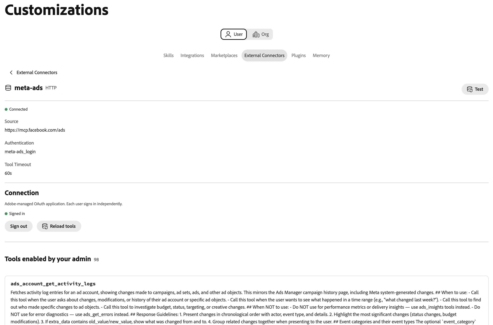

# Conector externo de Meta Ads {#meta-ads}

Use el conector externo [!DNL Meta Ads] para trabajar con los datos de publicidad [!DNL Meta] en Adobe CX Enterprise Coworker. Una vez configurado el conector, pídale a su compañero que informe sobre el rendimiento del anuncio, administre campañas y audiencias, trabaje con catálogos de productos y mucho más. El conector es un servidor de Protocolo de contexto de modelo (MCP) alojado por [!DNL Meta].

>[!AVAILABILITY]
>
>El conector externo [!DNL Meta Ads] está en versión beta. La documentación y las funcionalidades están sujetas a cambios.

## Configuración del conector {#connector-configuration}

El proceso de configuración del conector tiene dos partes independientes:

* **Configuración de la organización:** Un administrador configura el conector una vez para toda la organización. El administrador elige la aplicación OAuth y selecciona las herramientas que los miembros pueden utilizar.
* **Inicio de sesión de miembro:** Cada miembro inicia sesión con su propia cuenta de [!DNL Facebook]. Los miembros solo pueden acceder a los recursos de [!DNL Meta] que su identidad de [!DNL Facebook] y la aplicación autorizada permiten.

Al guardar la configuración de la organización, no se inicia sesión en ningún miembro ni se concede acceso a las cuentas de publicidad. Cada miembro debe iniciar sesión por separado.

## Requisitos previos {#prerequisites}

Antes de empezar, asegúrese de que dispone de lo siguiente:

* **Para la configuración de la organización:** Cuenta con permiso para administrar conectores de organización en Coworker.
* **Para el inicio de sesión de un miembro:** Una cuenta de [!DNL Facebook] con acceso a las cuentas de publicidad, negocios, páginas u otros [!DNL Meta] recursos que planea usar.
* **Para su propia aplicación OAuth (opcional):** Una aplicación [!DNL Meta] que administra su organización, junto con su ID de aplicación y secreto de aplicación.

## Configure el conector para su organización {#configure-organization}

Los administradores ponen el conector [!DNL Meta Ads] a disposición de todos los miembros de la organización. Los cambios en la página de organización se aplican a todos los usuarios de la organización.

1. Abra **[!UICONTROL Personalizaciones]**, seleccione **[!UICONTROL Organización]** y luego seleccione **[!UICONTROL Conectores externos]**. En la tarjeta **[!UICONTROL Meta Ads]**, seleccione **[!UICONTROL Configurar]**.

1. En el cuadro de diálogo **[!UICONTROL Configurar Meta Ads para su organización]**, revise los **[!UICONTROL detalles de conexión]** y, a continuación, seleccione una **[!UICONTROL aplicación de OAuth]**:

   * **[!UICONTROL Aplicación OAuth administrada por Adobe]:** Adobe proporciona la aplicación [!DNL Meta Ads], por lo que no es necesario que especifique las credenciales de la aplicación. Cada miembro sigue iniciando sesión con su propia cuenta de [!DNL Facebook] después de guardar.

     {width="500" zoomable="yes"}

   * **[!UICONTROL Usar mi propia aplicación OAuth]:** Su organización proporciona su propia aplicación [!DNL Meta]. Los miembros autorizan la aplicación, no la aplicación de Adobe. En **[!UICONTROL Su aplicación de Meta]**, complete los siguientes pasos:

     1. Copie la **[!UICONTROL URL de redireccionamiento]** y agréguela a la configuración de inicio de sesión de la aplicación [!DNL Meta]. Utilice el valor exacto que se muestra en el cuadro de diálogo, ya que la dirección URL de redireccionamiento difiere entre los entornos.
     1. En **[!UICONTROL De dónde provienen las credenciales]**, seleccione **[!UICONTROL Escriba nuevo]** y, a continuación, escriba el **[!UICONTROL id. de aplicación de Meta]** y **[!UICONTROL secreto de aplicación de Meta]**. Busque el ID de aplicación en la configuración básica de la aplicación [!DNL Meta]. El compañero almacena el secreto de la aplicación como un secreto de organización. Para reutilizar las credenciales guardadas para la misma aplicación, seleccione **[!UICONTROL Usar un secreto existente]**.
     1. Ponga la aplicación a disposición de los miembros que inicien sesión. Pida al administrador de la aplicación [!DNL Meta] que confirme los permisos necesarios y cualquier requisito de revisión de la aplicación para el uso previsto.

     El indicador **[!UICONTROL Detectado desde el servidor MCP]** confirma que Coworker encontró el conector. No confirma que las credenciales de la aplicación sean válidas ni que los miembros hayan iniciado sesión. Para actualizar la detección, seleccione **[!UICONTROL Volver a descubrir]**.

     {width="500" zoomable="yes"}

1. En **[!UICONTROL Herramientas disponibles para los usuarios]**, expanda cada grupo de herramientas y seleccione las herramientas que su organización necesita. Para cambiar todas las herramientas a la vez, usa **[!UICONTROL Seleccionar todo]** o **[!UICONTROL Borrar todo]**. Para obtener más información, consulte [Grupos de herramientas](#tool-groups). Luego selecciona **[!UICONTROL Guardar conexión]**.

   {width="500" zoomable="yes"}

1. Revise los detalles guardados del conector **[!UICONTROL meta-ads]**. De forma opcional, seleccione **[!UICONTROL Test]** para comprobar que el Compañero de trabajo puede descubrir las herramientas del conector.

   | Configuración | Descripción |
   | --- | --- |
   | **[!UICONTROL Source]** | El servidor MCP [!DNL Meta Ads], `https://mcp.facebook.com/ads`. |
   | **[!UICONTROL Autenticación]** | El método de autenticación `meta-ads_login`. |
   | **[!UICONTROL Conexión]** | La aplicación OAuth en uso y su propio estado de inicio de sesión. |
   | **[!UICONTROL Herramientas]** | Las herramientas seleccionadas para los miembros, con los controles **[!UICONTROL Seleccionar todo]** y **[!UICONTROL Borrar]** y un recuento de las herramientas seleccionadas. |

   {width="700" zoomable="yes"}

El estado **[!UICONTROL Sin sesión iniciada]** en los detalles del conector hace referencia a su propia conexión, no a la organización. Para usar el conector, selecciona **[!UICONTROL Iniciar sesión]** y sigue los pasos indicados en [Iniciar sesión como miembro](#sign-in-as-a-member).

Para dejar de ofrecer el conector a tu organización, selecciona **[!UICONTROL Quitar]** en la página de detalles del conector.

### Grupos de herramientas {#tool-groups}

El conector [!DNL Meta Ads] organiza sus herramientas en los siguientes grupos:

* [!UICONTROL Informes e información]
* [!UICONTROL Anuncios, campañas y audiencias]
* [!UICONTROL Catálogos y productos]
* [!UICONTROL Señales y conjuntos de datos]
* [!UICONTROL Pruebas A/B y estudios de alza]
* [!UICONTROL Registros de actividades]
* [!UICONTROL Ayuda y solución de problemas]

Por ejemplo, el grupo [!UICONTROL Informes e información] incluye herramientas como `ads_insights_performance_trend` y `ads_insights_industry_benchmark`. Las herramientas de cada grupo pueden cambiar a medida que [!DNL Meta] actualiza el conector.

>[!IMPORTANT]
>
>No todas las herramientas son de solo lectura. Algunas herramientas pueden cambiar campañas, presupuestos, audiencias, catálogos u otros recursos publicitarios. Seleccione solo las herramientas que su organización desea que utilicen los miembros.

Una vez guardadas, las herramientas que no haya seleccionado no estarán disponibles para los miembros hasta que las seleccione. Para confirmar qué herramientas pueden utilizar los miembros, revise la sección **[!UICONTROL Herramientas disponibles]** en la página de detalles del conector.

## Iniciar sesión como miembro {#sign-in-as-a-member}

Cuando un administrador configura el conector, cada miembro inicia sesión con su propia cuenta de [!DNL Facebook]. No necesita un secreto de aplicación o un token de acceso para iniciar sesión.

1. Abra **[!UICONTROL Personalizaciones]**, seleccione **[!UICONTROL Usuario]** y, a continuación, seleccione **[!UICONTROL Conectores externos]**.

1. En la tarjeta **[!UICONTROL Meta Ads]**, seleccione **[!UICONTROL Iniciar sesión]**.

   Si la tarjeta muestra **[!UICONTROL No configurado]** o el conector no está disponible, pídale al administrador que [configure el conector](#configure-organization).

1. Inicie sesión en [!DNL Facebook] y complete las indicaciones necesarias, como el inicio de sesión único (SSO), la autenticación multifactor (MFA), el consentimiento o la verificación de identidad.

   El orden de estos indicadores depende de las políticas de su cuenta y organización. Los usuarios nuevos también pueden ver solicitudes para conceder permisos y seleccionar recursos.

1. Revise la cuenta de [!DNL Facebook] y la aplicación que está autorizando y, a continuación, siga uno de estos procedimientos:

   * Para conservar la configuración anterior, selecciona **[!UICONTROL Continuar]**.
   * Para revisar o cambiar la autorización, seleccione **[!UICONTROL Editar configuración]**.
   * Para usar una cuenta de [!DNL Facebook] diferente, seleccione **[!UICONTROL Iniciar sesión en otra cuenta]**.

   Con la aplicación administrada por Adobe, usted autoriza a [!DNL Adobe Experience Cloud]. Con la aplicación de su propia organización, el nombre de la aplicación y las indicaciones difieren.

   {width="400" zoomable="yes"}

   >[!IMPORTANT]
   >
   >La aplicación recibe acceso continuo a la información que comparte y [!DNL Meta] registra cuándo la aplicación accede a esa información. Continúe solo si su organización aprueba el acceso solicitado.

1. Después de que [!DNL Facebook] le devuelva a Coworker, abra los detalles del conector **[!UICONTROL meta-ads]**. Confirme que el conector muestra **[!UICONTROL Conectado]** y **[!UICONTROL iniciado sesión]**.

   {width="700" zoomable="yes"}

1. Revise **[!UICONTROL Herramientas habilitadas por el administrador]** para ver las herramientas que puede usar.

Los detalles del conector también muestran la configuración **[!UICONTROL Tiempo de espera de herramienta]** y los siguientes controles:

* **[!UICONTROL Herramientas de recarga]:** Actualice la lista de herramientas.
* **[!UICONTROL Prueba]:** Comprueba que el Compañero de trabajo puede descubrir las herramientas del conector.
* **[!UICONTROL Cerrar sesión]:** Desconecta tu cuenta de [!DNL Facebook] del conector.

El estado **[!UICONTROL Conectado]** no confirma el acceso a una cuenta de publicidad específica o que todas las herramientas se ejecuten correctamente. Para confirmar tu acceso, [comprueba el acceso a tu cuenta de publicidad](#check-ad-account-access).

## Compruebe el acceso a su cuenta de publicidad {#check-ad-account-access}

Para confirmar qué cuentas de publicidad puede utilizar, inicie un chat e introduzca una solicitud de solo lectura.

Mensaje de ejemplo:

* &quot;¿A qué cuentas de anuncios de Meta puedo acceder? Enumérelos sin cambiar nada&quot;.

Si el administrador habilitó la herramienta `ads_get_ad_accounts`, Coworker enumera las cuentas publicitarias a las que puede acceder. Para cada cuenta, Coworker muestra la empresa propietaria, la elegibilidad de MCP y la disponibilidad de informes. Elija una cuenta accesible antes de solicitar informes o realizar acciones.

## Solucionar problemas de acceso {#troubleshoot-access}

Si no puede acceder a sus recursos de [!DNL Meta], haga lo siguiente:

| Área | Qué comprobar |
| --- | --- |
| Cuenta de [!DNL Facebook] | Ha iniciado sesión con la cuenta de [!DNL Facebook] que tiene acceso a la cuenta de publicidad. |
| Permisos de recursos | Su cuenta de [!DNL Facebook] tiene permisos para las cuentas de publicidad, empresas o páginas que desee usar. |
| Autorización de aplicaciones | Ha autorizado la aplicación y compartido los recursos necesarios. Para revisar la autorización, cierre sesión y vuelva a iniciarla, y después seleccione **[!UICONTROL Editar configuración]**. |
| Herramientas habilitadas | El administrador habilitó las herramientas que necesita en **[!UICONTROL Herramientas disponibles para los usuarios]**. |
| Su propia aplicación de OAuth | La URL de redireccionamiento coincide exactamente, el ID de aplicación y el secreto de la aplicación son correctos y los miembros tienen acceso a la aplicación. Confirme los permisos necesarios con el administrador de la aplicación [!DNL Meta]. |
